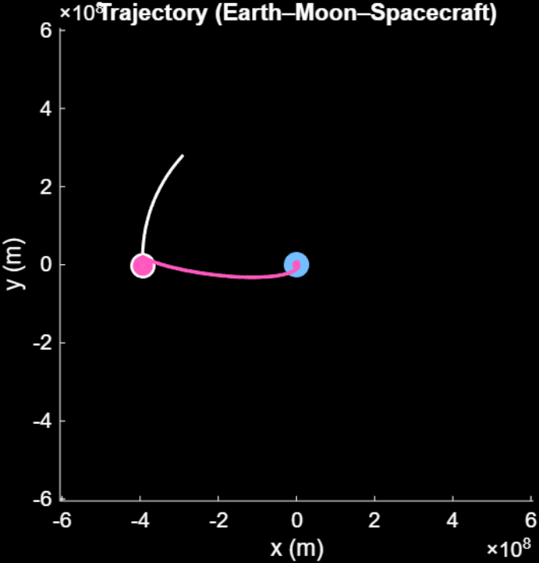
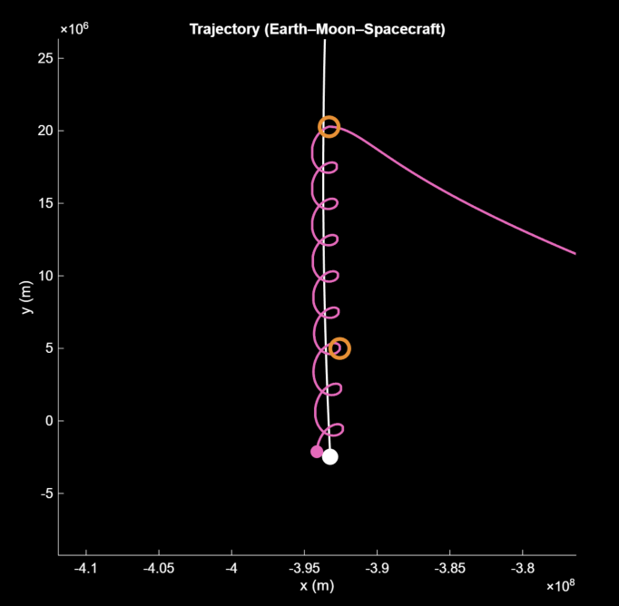
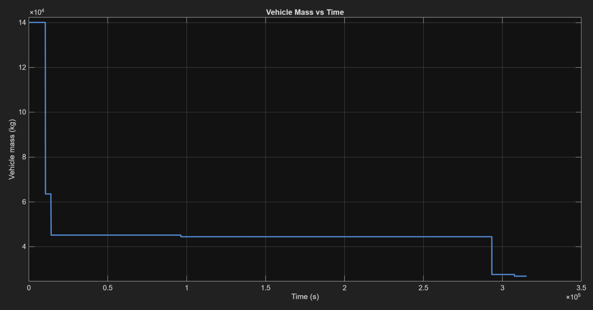
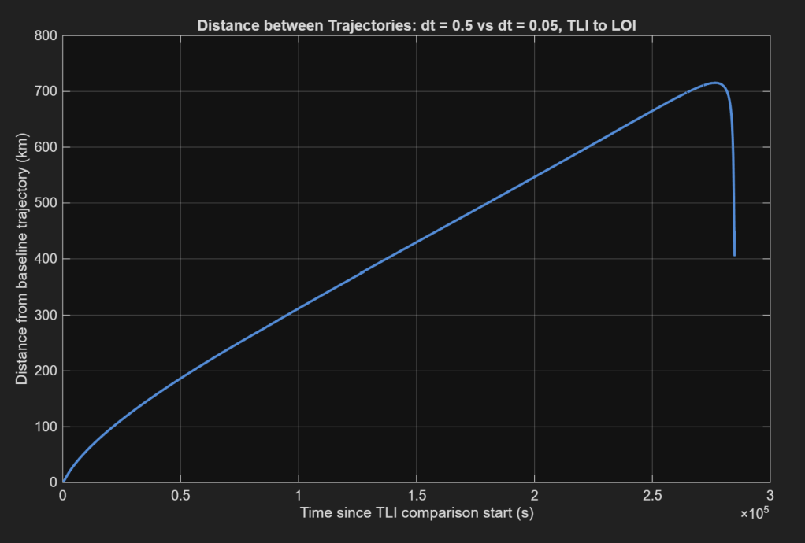
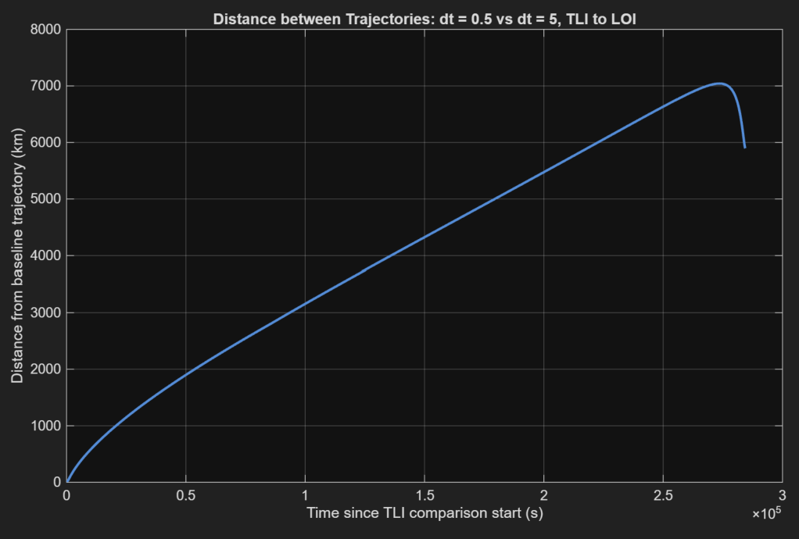
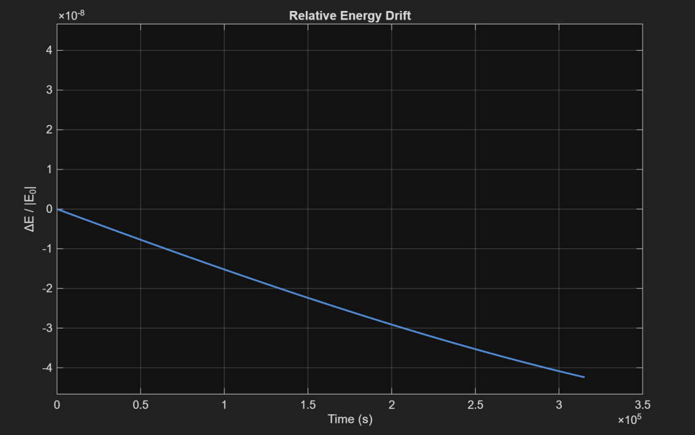
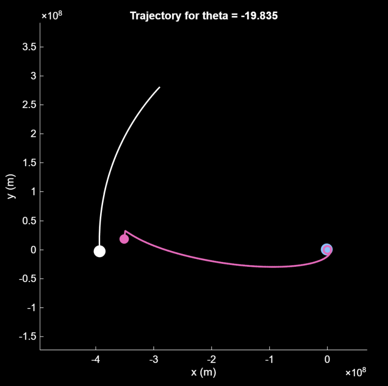
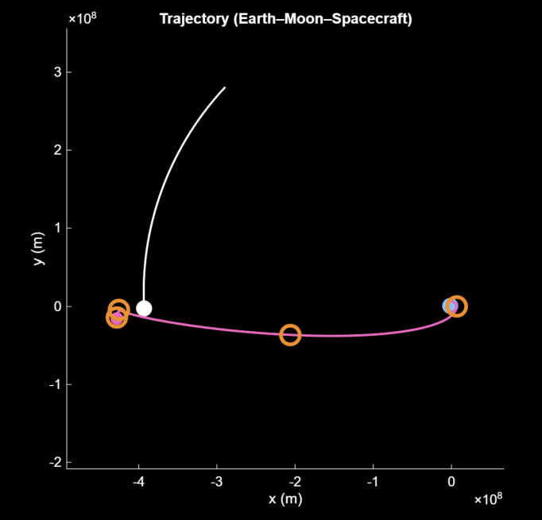

# Apollo 11 Trajectory Simulation

A MATLAB simulation of the Apollo 11 mission from Earth parking orbit through translunar injection, lunar orbit insertion, and circularization. The project uses a two-dimensional gravitational three-body model to reconstruct the spacecraft trajectory, estimate fuel consumption, and analyze sensitivity to timestep size and initial burn angle.

Developed for Intro to Computer Simulation (MATH-UA 144) at NYU.

## Physical Model

The Earth, Moon, and spacecraft are modeled as three point masses interacting through Newtonian gravity. Initial lunar position and velocity are taken from JPL Horizons at the time of the Apollo 11 launch. The simulation uses the $x$ and $y$ components of these data, neglecting the smaller out-of-plane component. All calculations use SI units.

### Equations of motion

For body $i$, let $\mathbf{x}_i$ be its position, $\mathbf{u}_i$ its velocity, and $m_i$ its mass. The equations of motion are

$$
\frac{d\mathbf{u}_i}{dt} = G\sum_{j\ne i}m_j\frac{\mathbf{x}_j-\mathbf{x}_i}{\|\mathbf{x}_j-\mathbf{x}_i\|^3},\qquad
\frac{d\mathbf{x}_i}{dt}=\mathbf{u}_i.
$$

The simulation uses **Symplectic Euler** to integrate these equations:

$$
\mathbf{u}_i^{k+1}=\mathbf{u}_i^k+\Delta t\,G\sum_{j\ne i}m_j\frac{\mathbf{x}_j^k-\mathbf{x}_i^k}{\|\mathbf{x}_j^k-\mathbf{x}_i^k\|^3}
$$

$$
\mathbf{x}_i^{k+1}=\mathbf{x}_i^k+\Delta t\,\mathbf{u}_i^{k+1}.
$$

Velocities are updated first, and the updated velocities are then used to calculate the new positions. The baseline simulation uses a timestep of 0.5 seconds.

### Rocket burns

Burns are modeled as instantaneous changes in velocity and spacecraft mass. Fuel consumption is calculated using the Tsiolkovsky rocket equation:

$$
\Delta v=I_{sp}g_0\ln\left(\frac{m_{\mathrm{before}}}{m_{\mathrm{after}}}\right),\qquad
m_{\mathrm{after}}=m_{\mathrm{before}}e^{-\Delta v/(I_{sp}g_0)}.
$$

The nominal historical mission events, measured from liftoff, are:

| Event | Historical elapsed time | Simulation method |
|---|---|---|
| Translunar injection (TLI) | 02:44:16 | Preset velocity change and burn angle |
| Midcourse correction (MCC) | 26:44:58 | Preset corrective velocity change |
| Lunar orbit insertion (LOI) | 75:49:50 | Retrograde burn near lunar periapsis |
| Lunar orbit circularization | 80:11:36 | Adjust velocity toward circular orbital speed |

The S-IVB stage is detached after TLI, reducing the spacecraft mass. The simulated TLI timing and angle are tuned; LOI and circularization are determined by the simulated trajectory rather than imposed at their historical timestamps.

For LOI, the target elliptical orbital speed is calculated using the vis-viva equation, where $r$ is the spacecraft's distance from the Moon's center at the burn and $a$ is the desired semi-major axis:

$$
v_{\mathrm{ellipse}}=\sqrt{GM_{\mathrm{Moon}}\left(\frac{2}{r}-\frac{1}{a}\right)}.
$$

For circularization, the target speed is

$$
v_{\mathrm{circle}}=\sqrt{\frac{GM_{\mathrm{Moon}}}{r}}.
$$

Both velocities are relative to the Moon. The burns assume the spacecraft velocity is approximately tangential to the desired orbit.

## Simulation Results

### Earth-to-Moon trajectory



Earth is blue, the Moon is white, and the spacecraft and its trajectory are pink. Orange markers in the burn-marked plots indicate the locations of burns. The baseline uses a TLI angle of -18.335° relative to the spacecraft's velocity.



The zoomed-in trajectory shows the lunar orbit insertion and subsequent circularization, which produces a small but visible change in the orbit.

### Spacecraft mass and fuel consumption



The mass drops correspond to the four burns and the separation of the S-IVB stage. TLI accounts for the largest fuel expenditure; the separation-related mass loss is excluded from the fuel calculation.

The baseline simulation consumes approximately **94,869 kg of fuel**, compared with the historical estimate of approximately 103,000 kg (about 8% lower). It reaches circularization after approximately 79 hours and 24 minutes of simulated time. With the different start time accounted for, the report estimates a difference of approximately 22 minutes from the historical timeline.

## Sensitivity and Numerical Accuracy

### Timestep sensitivity

The spacecraft's position from TLI to LOI is stored and compared with the baseline at matching times using linear interpolation. The distance between trajectories is

$$
D(t)=\sqrt{[x(t)-x_{\mathrm{base}}(t)]^2+[y(t)-y_{\mathrm{base}}(t)]^2}.
$$



At a timestep of 0.05 seconds, the maximum deviation from the 0.5-second baseline is 715.271 km and the mean deviation is 404.446 km. Although small on the Earth–Moon distance scale, these differences are significant on the scale of lunar orbit.



Increasing the timestep to 5 seconds while holding the initial burn angle fixed results in substantially larger trajectory deviation and improper lunar insertion. The 0.5-second baseline balances numerical accuracy and runtime.

### Energy analysis

The total mechanical energy of the three-body system is calculated at each timestep:

$$
E(t)=\frac12\sum_{i=1}^{3}m_i\|\mathbf{u}_i\|^2-G\sum_{i<j}\frac{m_i m_j}{\|\mathbf{x}_i-\mathbf{x}_j\|}.
$$

The signed relative energy drift is

$$
\frac{E(t)-E(0)}{|E(0)|}.
$$



The baseline plot shows relative drift on the order of $10^{-8}$; the coarser run in the writeup shows drift roughly an order of magnitude larger. This is a diagnostic of the overall model, not a pure measure of integration error: burns and stage separation also change the mechanical energy of the modeled bodies.

### Initial burn angle sensitivity

Keeping other parameters fixed at the baseline values, the TLI angle is changed by ±1.5°:

| TLI angle | Maximum deviation (km) | Mean deviation (km) |
|---|---:|---:|
| -19.835° (-1.5°) | 45,520.143 | 19,785.780 |
| -16.835° (+1.5°) | 38,631.352 | 17,851.707 |

| -1.5° burn angle error | +1.5° burn angle error |
|---|---|
|  |  |

Both perturbed trajectories fail to achieve the intended lunar orbit, demonstrating the strong sensitivity of the transfer to the initial burn direction.

## Running the Simulation

Open the repository folder in MATLAB and run one of the following scripts from the Command Window:

| Script | Purpose |
|---|---|
| `apollo_simulation1.m` | Standalone trajectory simulation and plots |
| `apollo_baseline_saver1.m` | Generates and saves the 0.5-second baseline trajectory |
| `apollo_compare_to_baseline_seconds_consistent_video1.m` | Compares a modified trajectory against the saved baseline |

To run the baseline and then the comparison:

```matlab
apollo_baseline_saver1
apollo_compare_to_baseline_seconds_consistent_video1
```

The first script creates `apollo_baseline_TLI_to_LOI.mat`, which the comparison script loads. Change `dt` to investigate timestep sensitivity or `TLIangle` to investigate burn angle sensitivity. Set `makeVideo = false` to disable MP4 recording.

The scripts generate trajectory, mass, total energy, and relative energy drift plots. The comparison script also generates a distance-from-baseline plot and prints the maximum and mean deviations. The figures above are taken from the project writeup; reproducing a particular run requires selecting its corresponding parameters.

## Data Sources

- [JPL Horizons System](https://ssd.jpl.nasa.gov/horizons/app.html#/) — lunar ephemeris data
- [Apollo 11 Mission Timeline](https://www.apolloproject.com/sp-4029/Apollo_11i_Timeline.htm) — historical mission events
- [Weebau: Apollo 11](https://weebau.com/flights/apollo11.htm) — spacecraft and mission data
- [Apollo ManiaCs: S-IVB Third Stage](https://www.apollomaniacs.com/apollo/sv_s4be.htm) — rocket stage data
